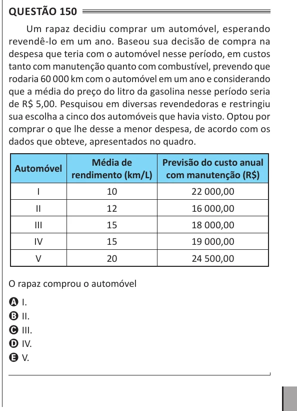

Texto extraído (pode conter ruído)

Questão 150  
Um rapaz decidiu comprar um automóvel, esperando  
revendê-lo em um ano. Baseou sua decisão de compra na  
despesa que teria com o automóvel nesse período, em custos  
tanto com manutenção quanto com combustível, prevendo que  
rodaria 60 000 km com o automóvel em um ano e considerando  
que a média do preço do litro da gasolina nesse período seria  
de R$ 5,00. Pesquisou em diversas revendedoras e restringiu  
sua escolha a cinco dos automóveis que havia visto. Optou por  
comprar o que lhe desse a menor despesa, de acordo com os  
dados que obteve, apresentados no quadro.  
Média de  
Previsão do custo anual  
Automóvel  
rendimento (km/L) com manutenção (R$)  
I  
10  
22 000,00  
II  
12  
16 000,00  
III  
15  
18 000,00  
IV  
15  
19 000,00  
V  
20  
24 500,00  
O rapaz comprou o automóvel  
A I.  
B II.  
C III.  
D IV.  
E V.

