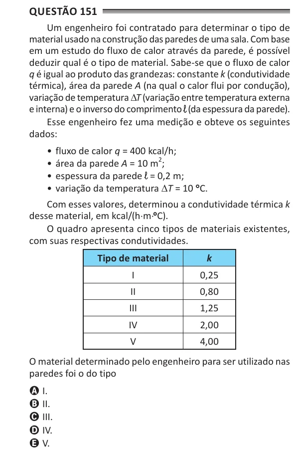

Texto extraído (pode conter ruído)

Questão 151  
Um engenheiro foi contratado para determinar o tipo de  
material usado na construção das paredes de uma sala. Com base  
em um estudo do fluxo de calor através da parede, é possível  
deduzir qual é o tipo de material. Sabe-se que o fluxo de calor  
q é igual ao produto das grandezas: constante k (condutividade  
térmica), área da parede A (na qual o calor flui por condução),  
variação de temperatura ∆T (variação entre temperatura externa  
e interna) e o inverso do comprimento ℓ (da espessura da parede).  
Esse engenheiro fez uma medição e obteve os seguintes  
dados:  
• fluxo de calor q = 400 kcal/h;  
• área da parede A = 10 m 2 ;  
• espessura da parede ℓ = 0,2 m;  
• variação da temperatura ∆T = 10 ° C.  
Com esses valores, determinou a condutividade térmica k  
desse material, em kcal/(h⋅m⋅°° C).  
O quadro apresenta cinco tipos de materiais existentes,  
com suas respectivas condutividades.  
tipo de material  
k  
I  
0,25  
II  
0,80  
III  
1,25  
IV  
2,00  
V  
4,00  
O material determinado pelo engenheiro para ser utilizado nas  
paredes foi o do tipo  
A I.  
B II.  
C III.  
D IV.  
E V.

