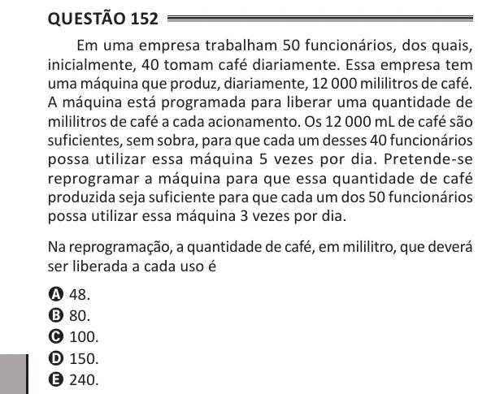

Texto extraído (pode conter ruído)

Questão 152  
Em uma empresa trabalham 50 funcionários, dos quais,  
inicialmente, 40 tomam café diariamente. Essa empresa tem  
uma máquina que produz, diariamente, 12 000 mililitros de café.  
A máquina está programada para liberar uma quantidade de  
mililitros de café a cada acionamento. Os 12 000 mL de café são  
suficientes, sem sobra, para que cada um desses 40 funcionários  
possa utilizar essa máquina 5 vezes por dia. Pretende-se  
reprogramar a máquina para que essa quantidade de café  
produzida seja suficiente para que cada um dos 50 funcionários  
possa utilizar essa máquina 3 vezes por dia.  
Na reprogramação, a quantidade de café, em mililitro, que deverá  
ser liberada a cada uso é  
A 48.  
B 80.  
C 100.  
D 150.  
E 240.

