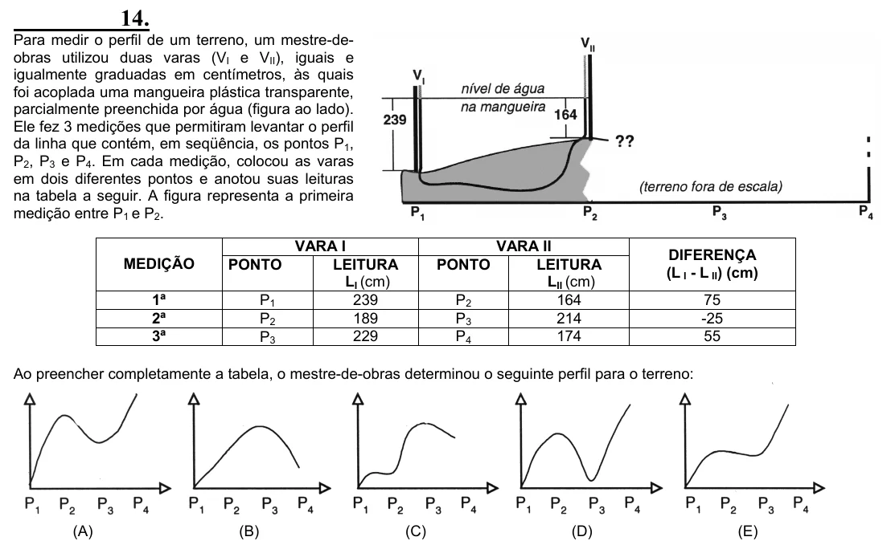

Texto extraído (pode conter ruído)

14.  
Para medir o perfil de um terreno, um mestre-de-  
obras utilizou duas varas (V I e V II ), iguais e  
igualmente graduadas em centímetros, às quais  
foi acoplada uma mangueira plástica transparente,  
parcialmente preenchida por água (figura ao lado).  
Ele fez 3 medições que permitiram levantar o perfil  
da linha que contém, em seqüência, os pontos P 1 ,  
P 2 , P 3 e P 4 . Em cada medição, colocou as varas  
em dois diferentes pontos e anotou suas leituras  
na tabela a seguir. A figura representa a primeira  
medição entre P 1 e P 2 .  
VARA I  
VARA II  
DIFERENÇA  
MEDIÇÃO  
PONTO  
LEITURA  
PONTO  
LEITURA  
(L I - L II ) (cm)  
L I (cm)  
L II (cm)  
1ª  
P 1  
239  
P 2  
164  
75  
2ª  
P 2  
189  
P 3  
214  
-25  
3ª  
P 3  
229  
P 4  
174  
55  
Ao preencher completamente a tabela, o mestre-de-obras determinou o seguinte perfil para o terreno:  
(A)  
(B)  
(C)  
(D)  
(E)

