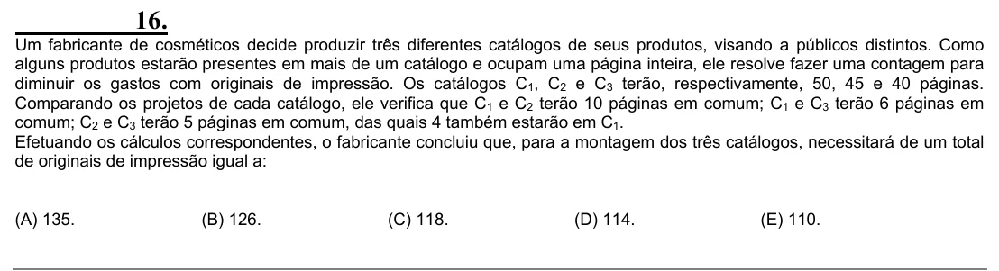

Texto extraído (pode conter ruído)

16.  
Um fabricante de cosméticos decide produzir três diferentes catálogos de seus produtos, visando a públicos distintos. Como  
alguns produtos estarão presentes em mais de um catálogo e ocupam uma página inteira, ele resolve fazer uma contagem para  
diminuir os gastos com originais de impressão. Os catálogos C 1 , C 2 e C 3 terão, respectivamente, 50, 45 e 40 páginas.  
Comparando os projetos de cada catálogo, ele verifica que C 1 e C 2 terão 10 páginas em comum; C 1 e C 3 terão 6 páginas em  
comum; C 2 e C 3 terão 5 páginas em comum, das quais 4 também estarão em C 1 .  
Efetuando os cálculos correspondentes, o fabricante concluiu que, para a montagem dos três catálogos, necessitará de um total  
de originais de impressão igual a:  
(A) 135.  
(B) 126.  
(C) 118.  
(D) 114.  
(E) 110.

