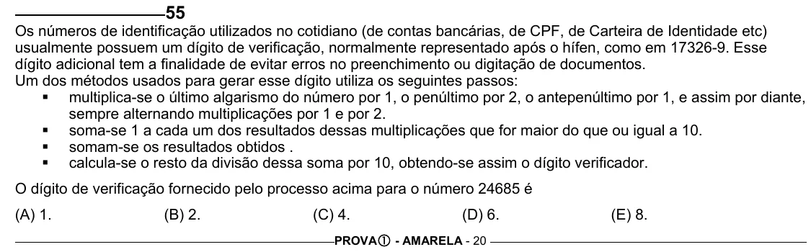

Texto extraído (pode conter ruído)

55  
Os números de identificação utilizados no cotidiano (de contas bancárias, de CPF, de Carteira de Identidade etc)  
usualmente possuem um dígito de verificação, normalmente representado após o hífen, como em 17326-9. Esse  
dígito adicional tem a finalidade de evitar erros no preenchimento ou digitação de documentos.  
Um dos métodos usados para gerar esse dígito utiliza os seguintes passos:  
ƒ multiplica-se o último algarismo do número por 1, o penúltimo por 2, o antepenúltimo por 1, e assim por diante,  
sempre alternando multiplicações por 1 e por 2.  
ƒ soma-se 1 a cada um dos resultados dessas multiplicações que for maior do que ou igual a 10.  
ƒ somam-se os resultados obtidos .  
ƒ calcula-se o resto da divisão dessa soma por 10, obtendo-se assim o dígito verificador.  
O dígito de verificação fornecido pelo processo acima para o número 24685 é  
(A) 1.  
(B) 2.  
(C) 4.  
(D) 6.  
(E) 8.  
PROVA c - AMARELA - 20

