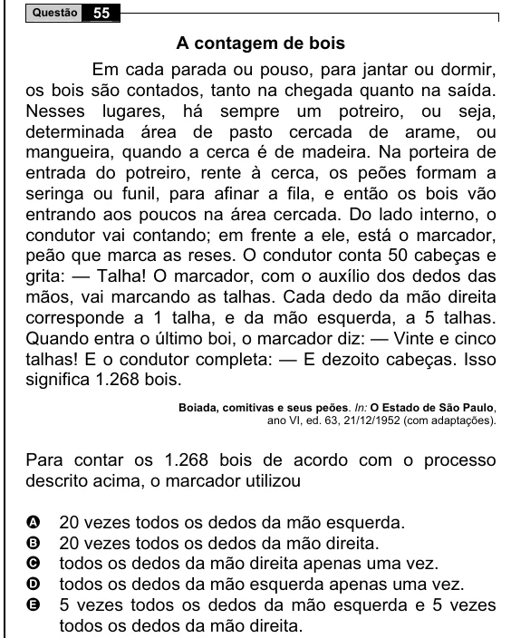

Texto extraído (pode conter ruído)

55  
Questão  
A contagem de bois  
Em cada parada ou pouso, para jantar ou dormir,  
os bois são contados, tanto na chegada quanto na saída.  
Nesses lugares, há sempre um potreiro, ou seja,  
determinada área de pasto cercada de arame, ou  
mangueira, quando a cerca é de madeira. Na porteira de  
entrada do potreiro, rente à cerca, os peões formam a  
seringa ou funil, para afinar a fila, e então os bois vão  
entrando aos poucos na área cercada. Do lado interno, o  
condutor vai contando; em frente a ele, está o marcador,  
peão que marca as reses. O condutor conta 50 cabeças e  
grita: — Talha! O marcador, com o auxílio dos dedos das  
mãos, vai marcando as talhas. Cada dedo da mão direita  
corresponde a 1 talha, e da mão esquerda, a 5 talhas.  
Quando entra o último boi, o marcador diz: — Vinte e cinco  
talhas! E o condutor completa: — E dezoito cabeças. Isso  
significa 1.268 bois.  
Boiada, comitivas e seus peões. In: O Estado de São Paulo,  
ano VI, ed. 63, 21/12/1952 (com adaptações).  
Para contar os 1.268 bois de acordo com o processo  
descrito acima, o marcador utilizou  
20 vezes todos os dedos da mão esquerda.  
A  
B  
20 vezes todos os dedos da mão direita.  
todos os dedos da mão direita apenas uma vez.  
C  
D  
todos os dedos da mão esquerda apenas uma vez.  
E  
5 vezes todos os dedos da mão esquerda e 5 vezes  
todos os dedos da mão direita.

