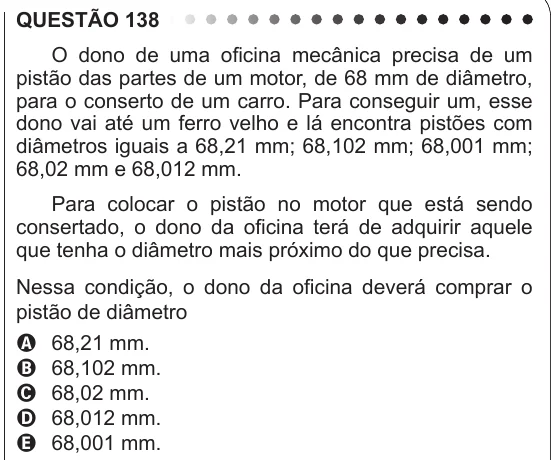

Texto extraído (pode conter ruído)

QUESTÃO 138  
O dono de uma oficina mecânica precisa de um  
pistão das partes de um motor, de 68 mm de diâmetro,  
para o conserto de um carro. Para conseguir um, esse  
dono vai até um ferro velho e lá encontra pistões com  
diâmetros iguais a 68,21 mm; 68,102 mm; 68,001 mm;  
68,02 mm e 68,012 mm.  
Para colocar o pistão no motor que está sendo  
consertado, o dono da oficina terá de adquirir aquele  
que tenha o diâmetro mais próximo do que precisa.  
Nessa condição, o dono da oficina deverá comprar o  
pistão de diâmetro  
A 68,21 mm.  
B 68,102 mm.  
C 68,02 mm.  
D 68,012 mm.  
E 68,001 mm.

