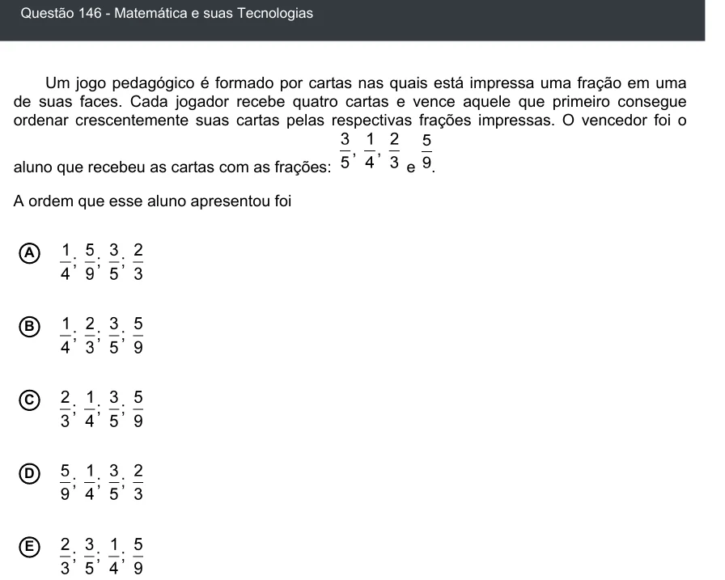

Texto extraído (pode conter ruído)

Questão 146 - Matemática e suas Tecnologias  
Um jogo pedagógico é formado por cartas nas quais está impressa uma fração em uma  
de suas faces. Cada jogador recebe quatro cartas e vence aquele que primeiro consegue  
ordenar crescentemente suas cartas pelas respectivas frações impressas. O vencedor foi o  
aluno que recebeu as cartas com as frações:  
e .  
A ordem que esse aluno apresentou foi  
A  
B  
C  
D  
E

