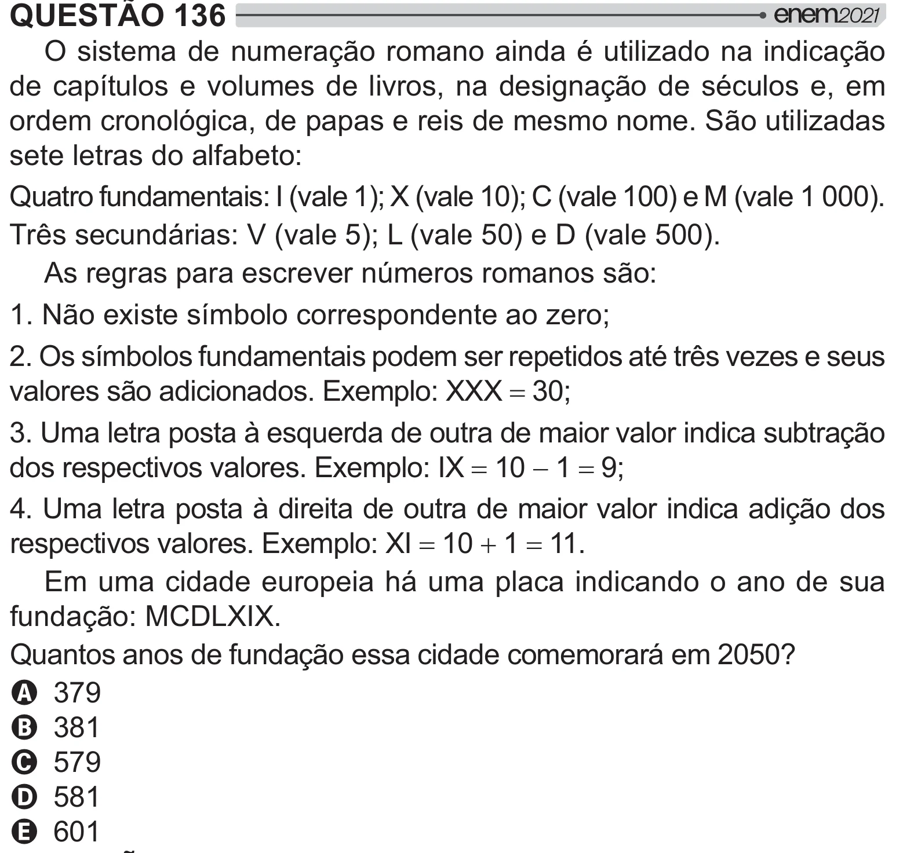

Texto extraído (pode conter ruído)

QUESTÃO 136  
O sistema de numeração romano ainda é utilizado na indicação  
de capítulos e volumes de livros, na designação de séculos e, em  
ordem cronológica, de papas e reis de mesmo nome. São utilizadas  
sete letras do alfabeto:  
Quatro fundamentais: I (vale 1); X (vale 10); C (vale 100) e M (vale 1 000).  
Três secundárias: V (vale 5); L (vale 50) e D (vale 500).  
As regras para escrever números romanos são:  
1. Não existe símbolo correspondente ao zero;  
2. Os símbolos fundamentais podem ser repetidos até três vezes e seus  
valores são adicionados. Exemplo: XXX 30;  
3. Uma letra posta à esquerda de outra de maior valor indica subtração  
dos respectivos valores. Exemplo: IX 10  1 9;  
4. Uma letra posta à direita de outra de maior valor indica adição dos  
respectivos valores. Exemplo: XI 10  1 11.  
Em uma cidade europeia há uma placa indicando o ano de sua  
fundação: MCDLXIX.  
&     > =[   / ‘__]  
A 379  
B 381  
C 579  
D 581  
E 601

