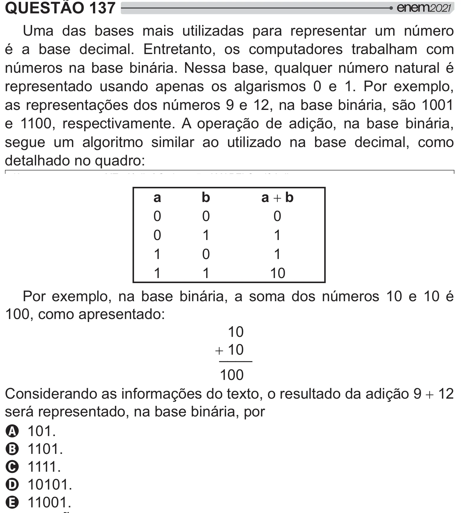

Texto extraído (pode conter ruído)

QUESTÃO 137  
Uma das bases mais utilizadas para representar um número  
é a base decimal. Entretanto, os computadores trabalham com  
números na base binária. Nessa base, qualquer número natural é  
representado usando apenas os algarismos 0 e 1. Por exemplo,  
as representações dos números 9 e 12, na base binária, são 1001  
e 1100, respectivamente. A operação de adição, na base binária,  
segue um algoritmo similar ao utilizado na base decimal, como  
detalhado no quadro:  
a  b  
a  
b  
0  
0  
0  
0  
1  
1  
1  
0  
1  
1  
1  
10  
Por exemplo, na base binária, a soma dos números 10 e 10 é  
100, como apresentado:  
10  
 ____  
10  
100  
Considerando as informações do texto, o resultado da adição 9  12  
será representado, na base binária, por  
A 101.  
B 1101.  
C 1111.  
D 10101.  
E 11001.

