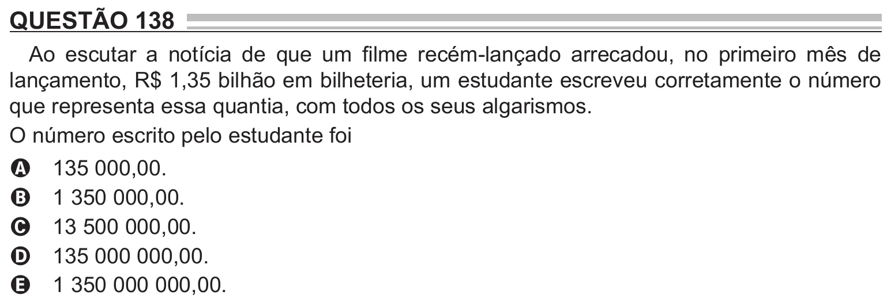

Texto extraído (pode conter ruído)

QUESTÃO 138  
Ao escutar a notícia de que um filme recém-lançado arrecadou, no primeiro mês de  
lançamento, R$ 1,35 bilhão em bilheteria, um estudante escreveu corretamente o número  
que representa essa quantia, com todos os seus algarismos.  
O número escrito pelo estudante foi  
135 000,00.  
A  
1 350 000,00.  
B  
13 500 000,00.  
C  
135 000 000,00.  
D  
1 350 000 000,00.  
E

