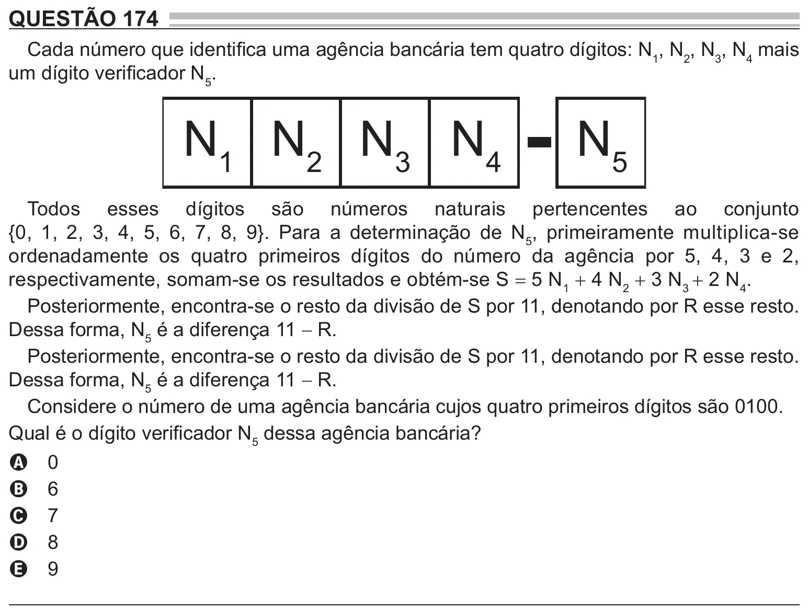

Texto extraído (pode conter ruído)

QUESTÃO 174  
Cada número que identifica uma agência bancária tem quatro dígitos: N 1 , N 2 , N 3 , N 4 mais  
um dígito verificador N 5 .  
N 1 N 2 N 3 N 4  
N 5  
Todos esses dígitos são números naturais pertencentes ao conjunto  
{0, 1, 2, 3, 4, 5, 6, 7, 8, 9}. Para a determinação de N 5 , primeiramente multiplica-se  
ordenadamente os quatro primeiros dígitos do número da agência por 5, 4, 3 e 2,  
respectivamente, somam-se os resultados e obtém-se S = 5 N 1 + 4 N 2 + 3 N 3 + 2 N 4 .  
Posteriormente, encontra-se o resto da divisão de S por 11, denotando por R esse resto.  
Dessa forma, N 5 é a diferença 11 − R.  
Posteriormente, encontra-se o resto da divisão de S por 11, denotando por R esse resto.  
Dessa forma, N 5 é a diferença 11 − R.  
Considere o número de uma agência bancária cujos quatro primeiros dígitos são 0100.  
Qual é o dígito verificador N 5 dessa agência bancária?  
0  
A  
6  
B  
7  
C  
8  
D  
9  
E

