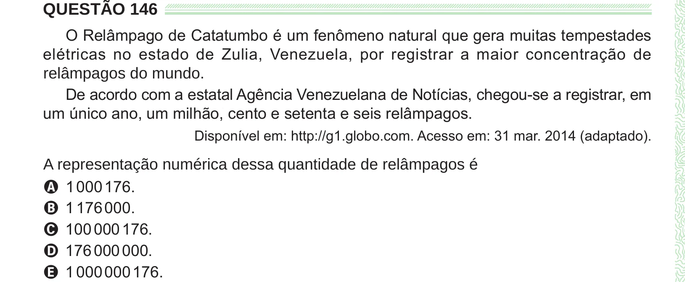

Texto extraído (pode conter ruído)

QUESTÃO 146  
O Relâmpago de Catatumbo é um fenômeno natural que gera muitas tempestades  
elétricas no estado de Zulia, Venezuela, por registrar a maior concentração de  
relâmpagos do mundo.  
De acordo com a estatal Agência Venezuelana de Notícias, chegou-se a registrar, em  
um único ano, um milhão, cento e setenta e seis relâmpagos.  
Disponível em: http://g1.globo.com. Acesso em: 31 mar. 2014 (adaptado).  
A representação numérica dessa quantidade de relâmpagos é  
A 1 000 176.  
B 1 176 000.  
C 100 000 176.  
D 176 000 000.  
E 1 000 000 176.

