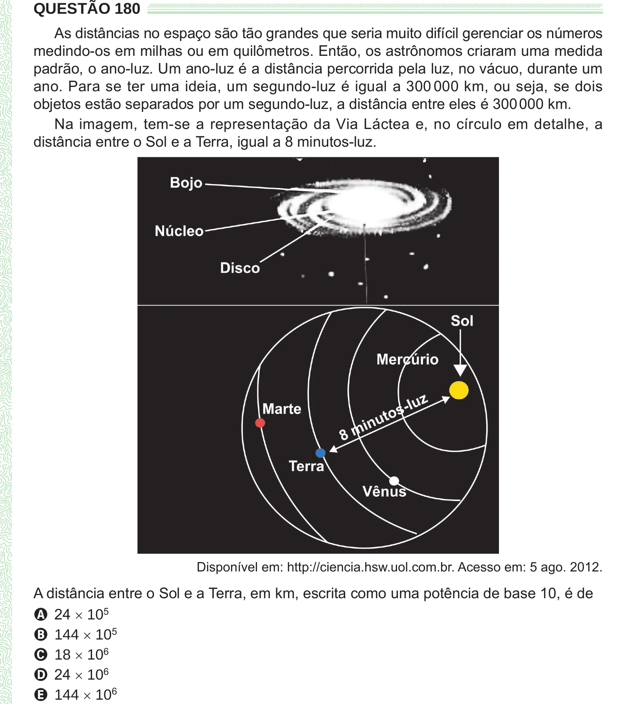

Texto extraído (pode conter ruído)

QUESTÃO 180  
As distâncias no espaço são tão grandes que seria muito difícil gerenciar os números  
medindo-os em milhas ou em quilômetros. Então, os astrônomos criaram uma medida  
padrão, o ano-luz. Um ano-luz é a distância percorrida pela luz, no vácuo, durante um  
ano. Para se ter uma ideia, um segundo-luz é igual a 300 000 km, ou seja, se dois  
objetos estão separados por um segundo-luz, a distância entre eles é 300 000 km.  
Na imagem, tem-se a representação da Via Láctea e, no círculo em detalhe, a  
distância entre o Sol e a Terra, igual a 8 minutos-luz.  
Disponível em: http://ciencia.hsw.uol.com.br. Acesso em: 5 ago. 2012.  
A distância entre o Sol e a Terra, em km, escrita como uma potência de base 10, é de  
A 24 × 10 5  
B 144 × 10 5  
C 18 × 10 6  
D 24 × 10 6  
E 144 × 10 6

