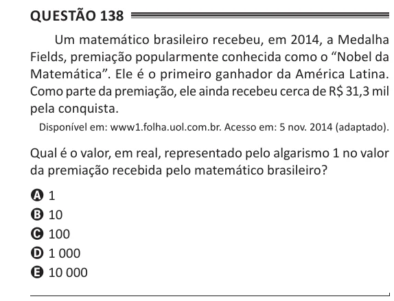

Texto extraído (pode conter ruído)

Questão 138  
Um matemático brasileiro recebeu, em 2014, a Medalha  
Fields, premiação popularmente conhecida como o “Nobel da  
Matemática”. Ele é o primeiro ganhador da América Latina.  
Como parte da premiação, ele ainda recebeu cerca de R$ 31,3 mil  
pela conquista.  
Disponível em: www1.folha.uol.com.br. Acesso em: 5 nov. 2014 (adaptado).  
Qual é o valor, em real, representado pelo algarismo 1 no valor  
da premiação recebida pelo matemático brasileiro?  
A 1  
B 10  
C 100  
D 1 000  
E 10 000

