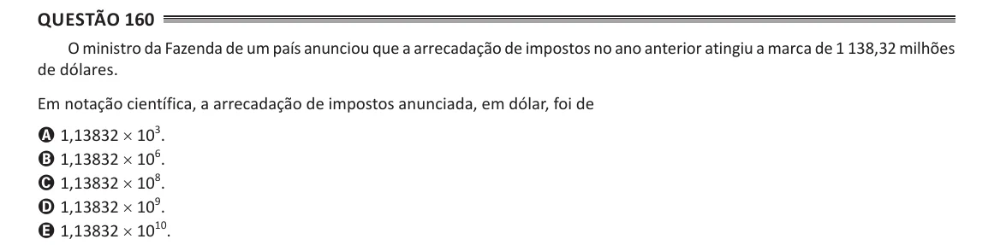

Texto extraído (pode conter ruído)

Questão 160  
O ministro da Fazenda de um país anunciou que a arrecadação de impostos no ano anterior atingiu a marca de 1 138,32 milhões  
de dólares.  
Em notação científica, a arrecadação de impostos anunciada, em dólar, foi de  
A 1,13832 × 10 3 .  
B 1,13832 × 10 6 .  
C 1,13832 × 10 8 .  
D 1,13832 × 10 9 .  
E 1,13832 × 10 10 .

