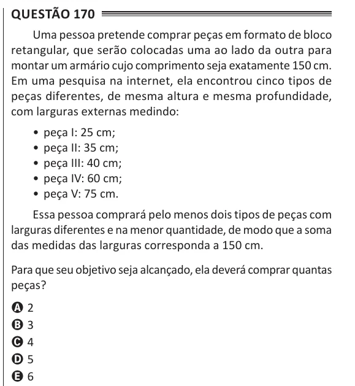

Texto extraído (pode conter ruído)

Questão 170  
Uma pessoa pretende comprar peças em formato de bloco  
retangular, que serão colocadas uma ao lado da outra para  
montar um armário cujo comprimento seja exatamente 150 cm.  
Em uma pesquisa na internet, ela encontrou cinco tipos de  
peças diferentes, de mesma altura e mesma profundidade,  
com larguras externas medindo:  
• peça I: 25 cm;  
• peça II: 35 cm;  
• peça III: 40 cm;  
• peça IV: 60 cm;  
• peça V: 75 cm.  
Essa pessoa comprará pelo menos dois tipos de peças com  
larguras diferentes e na menor quantidade, de modo que a soma  
das medidas das larguras corresponda a 150 cm.  
Para que seu objetivo seja alcançado, ela deverá comprar quantas  
peças?  
A 2  
B 3  
C 4  
D 5  
E 6

