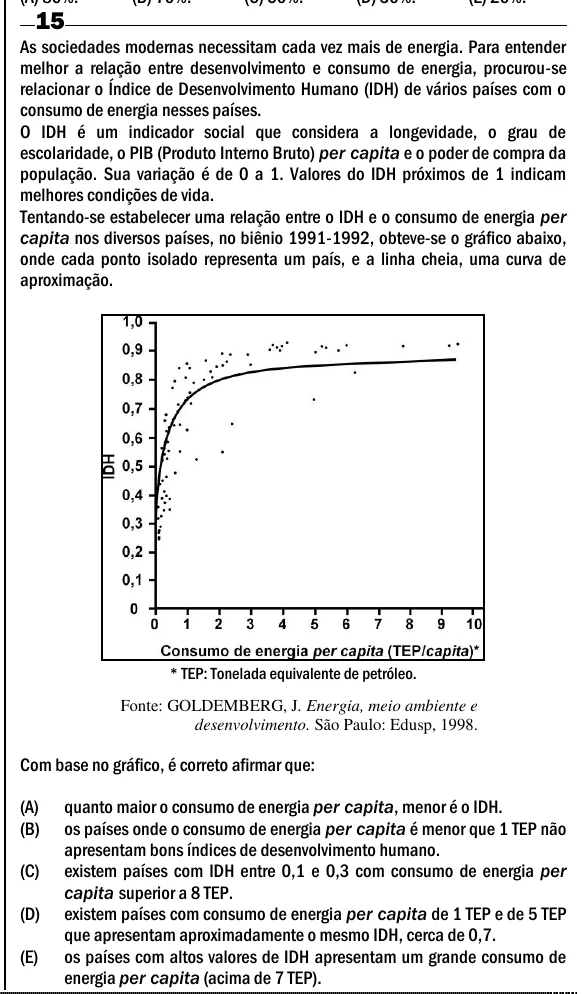

Texto extraído (pode conter ruído)

15  
As sociedades modernas necessitam cada vez mais de energia. Para entender  
melhor a relação entre desenvolvimento e consumo de energia, procurou-se  
relacionar o Índice de Desenvolvimento Humano (IDH) de vários países com o  
consumo de energia nesses países.  
O IDH é um indicador social que considera a longevidade, o grau de  
escolaridade, o PIB (Produto Interno Bruto) per capita e o poder de compra da  
população. Sua variação é de 0 a 1. Valores do IDH próximos de 1 indicam  
melhores condições de vida.  
Tentando-se estabelecer uma relação entre o IDH e o consumo de energia per  
capita nos diversos países, no biênio 1991-1992, obteve-se o gráfico abaixo,  
onde cada ponto isolado representa um país, e a linha cheia, uma curva de  
aproximação.  
* TEP: Tonelada equivalente de petróleo.  
Fonte: GOLDEMBERG, J. Energia, meio ambiente e  
desenvolvimento. São Paulo: Edusp, 1998.  
Com base no gráfico, é correto afirmar que:  
(A)  
quanto maior o consumo de energia per capita, menor é o IDH.  
(B)  
os países onde o consumo de energia per capita é menor que 1 TEP não  
apresentam bons índices de desenvolvimento humano.  
(C)  
existem países com IDH entre 0,1 e 0,3 com consumo de energia per  
capita superior a 8 TEP.  
(D)  
existem países com consumo de energia per capita de 1 TEP e de 5 TEP  
que apresentam aproximadamente o mesmo IDH, cerca de 0,7.  
(E)  
os países com altos valores de IDH apresentam um grande consumo de  
energia per capita (acima de 7 TEP).

