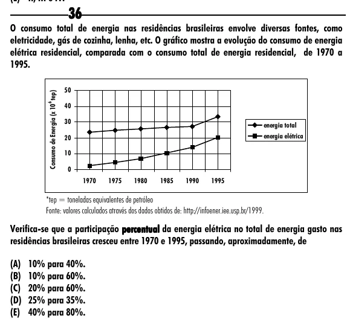

Texto extraído (pode conter ruído)

36  
O consumo total de energia nas residências brasileiras envolve diversas fontes, como  
eletricidade, gás de cozinha, lenha, etc. O gráfico mostra a evolução do consumo de energia  
elétrica residencial, comparada com o consumo total de energia residencial, de 1970 a  
1995.  
50  
Consumo de Energia (x 10 tep)  
6  
40  
30  
energia total  
20  
energia elétrica  
10  
0  
1970  
1975  
1980  
1985  
1990  
1995  
*tep = toneladas equivalentes de petróleo  
Fonte: valores calculados através dos dados obtidos de: http://infoener.iee.usp.br/1999.  
Verifica-se que a participação percentual da energia elétrica no total de energia gasto nas  
residências brasileiras cresceu entre 1970 e 1995, passando, aproximadamente, de  
(A) 10% para 40%.  
(B) 10% para 60%.  
(C) 20% para 60%.  
(D) 25% para 35%.  
(E) 40% para 80%.

