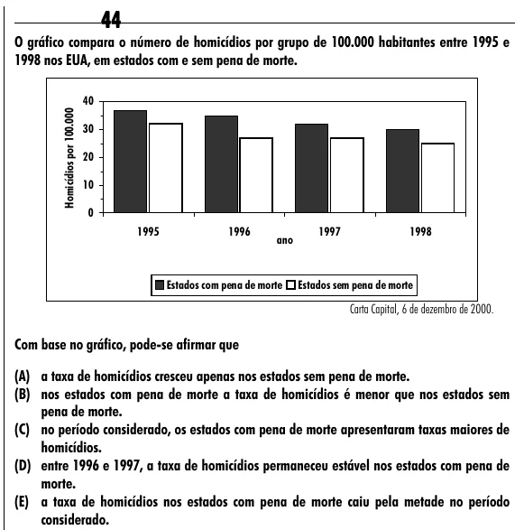

Texto extraído (pode conter ruído)

44  
O gráfico compara o número de homicídios por grupo de 100.000 habitantes entre 1995 e  
1998 nos EUA, em estados com e sem pena de morte.  
40  
Homicídios por 100.000  
30  
20  
10  
0  
1995  
1996  
1997  
1998  
ano  
Estados com pena de morte  
Estados sem pena de morte  
Carta Capital, 6 de dezembro de 2000.  
Com base no gráfico, pode-se afirmar que  
(A) a taxa de homicídios cresceu apenas nos estados sem pena de morte.  
(B) nos estados com pena de morte a taxa de homicídios é menor que nos estados sem  
pena de morte.  
(C) no período considerado, os estados com pena de morte apresentaram taxas maiores de  
homicídios.  
(D) entre 1996 e 1997, a taxa de homicídios permaneceu estável nos estados com pena de  
morte.  
(E) a taxa de homicídios nos estados com pena de morte caiu pela metade no período  
considerado.

