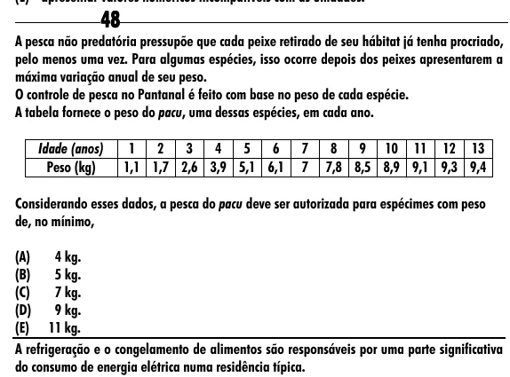

Texto extraído (pode conter ruído)

48  
A pesca não predatória pressupõe que cada peixe retirado de seu hábitat já tenha procriado,  
pelo menos uma vez. Para algumas espécies, isso ocorre depois dos peixes apresentarem a  
máxima variação anual de seu peso.  
O controle de pesca no Pantanal é feito com base no peso de cada espécie.  
A tabela fornece o peso do pacu, uma dessas espécies, em cada ano.  
Idade (anos)  
1  
2  
3  
4  
5  
6  
7  
8  
9 10 11 12 13  
Peso (kg)  
1,1 1,7 2,6 3,9 5,1 6,1  
7  
7,8 8,5 8,9 9,1 9,3 9,4  
Considerando esses dados, a pesca do pacu deve ser autorizada para espécimes com peso  
de, no mínimo,  
(A)  
4 kg.  
(B)  
5 kg.  
(C)  
7 kg.  
(D)  
9 kg.  
(E) 11 kg.  
A refrigeração e o congelamento de alimentos são responsáveis por uma parte significativa  
do consumo de energia elétrica numa residência típica.

