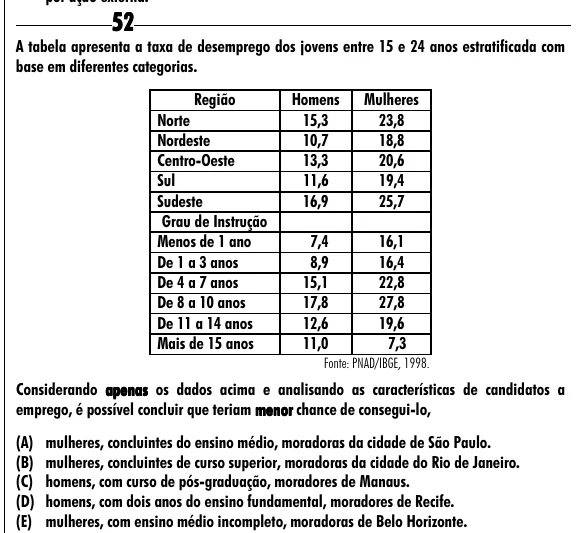

Texto extraído (pode conter ruído)

52  
A tabela apresenta a taxa de desemprego dos jovens entre 15 e 24 anos estratificada com  
base em diferentes categorias.  
Região  
Homens  
Mulheres  
Norte  
15,3  
23,8  
Nordeste  
10,7  
18,8  
Centro-Oeste  
13,3  
20,6  
Sul  
11,6  
19,4  
Sudeste  
16,9  
25,7  
Grau de Instrução  
Menos de 1 ano  
7,4  
16,1  
De 1 a 3 anos  
8,9  
16,4  
De 4 a 7 anos  
15,1  
22,8  
De 8 a 10 anos  
17,8  
27,8  
De 11 a 14 anos  
12,6  
19,6  
Mais de 15 anos  
11,0  
7,3  
Fonte: PNAD/IBGE, 1998.  
Considerando apenas os dados acima e analisando as características de candidatos a  
emprego, é possível concluir que teriam menor chance de consegui-lo,  
(A) mulheres, concluintes do ensino médio, moradoras da cidade de São Paulo.  
(B) mulheres, concluintes de curso superior, moradoras da cidade do Rio de Janeiro.  
(C) homens, com curso de pós-graduação, moradores de Manaus.  
(D) homens, com dois anos do ensino fundamental, moradores de Recife.  
(E) mulheres, com ensino médio incompleto, moradoras de Belo Horizonte.

