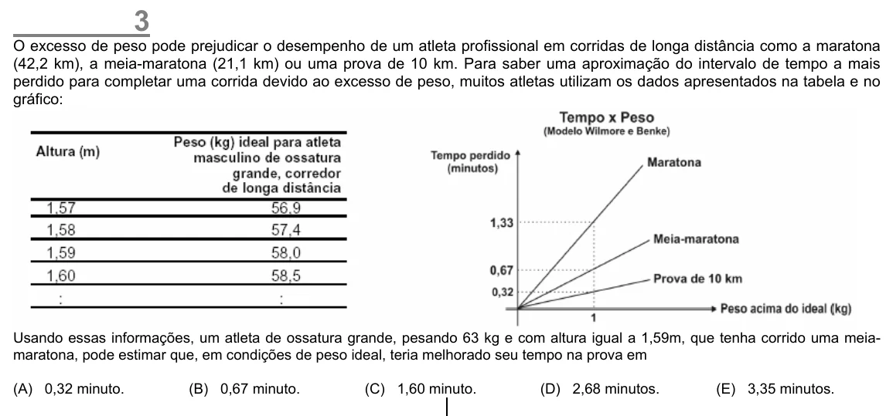

Texto extraído (pode conter ruído)

3  
O excesso de peso pode prejudicar o desempenho de um atleta profissional em corridas de longa distância como a maratona  
(42,2 km), a meia-maratona (21,1 km) ou uma prova de 10 km. Para saber uma aproximação do intervalo de tempo a mais  
perdido para completar uma corrida devido ao excesso de peso, muitos atletas utilizam os dados apresentados na tabela e no  
gráfico:  
Usando essas informações, um atleta de ossatura grande, pesando 63 kg e com altura igual a 1,59m, que tenha corrido uma meia-  
maratona, pode estimar que, em condições de peso ideal, teria melhorado seu tempo na prova em  
(A) 0,32 minuto.  
(B) 0,67 minuto.  
(C) 1,60 minuto.  
(D) 2,68 minutos.  
(E) 3,35 minutos.

