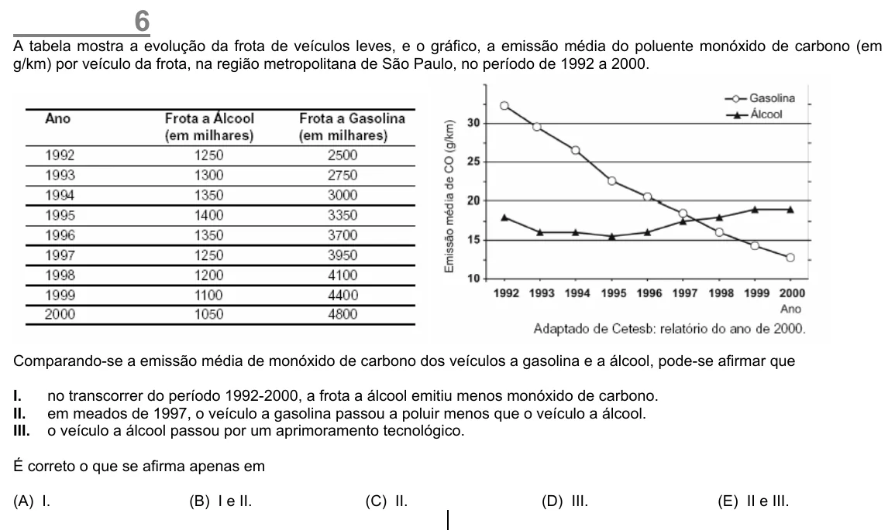

Texto extraído (pode conter ruído)

6  
A tabela mostra a evolução da frota de veículos leves, e o gráfico, a emissão média do poluente monóxido de carbono (em  
g/km) por veículo da frota, na região metropolitana de São Paulo, no período de 1992 a 2000.  
Comparando-se a emissão média de monóxido de carbono dos veículos a gasolina e a álcool, pode-se afirmar que  
I.  
no transcorrer do período 1992-2000, a frota a álcool emitiu menos monóxido de carbono.  
II.  
em meados de 1997, o veículo a gasolina passou a poluir menos que o veículo a álcool.  
III.  
o veículo a álcool passou por um aprimoramento tecnológico.  
É correto o que se afirma apenas em  
(A) I.  
(B) I e II.  
(C) II.  
(D) III.  
(E) II e III.

