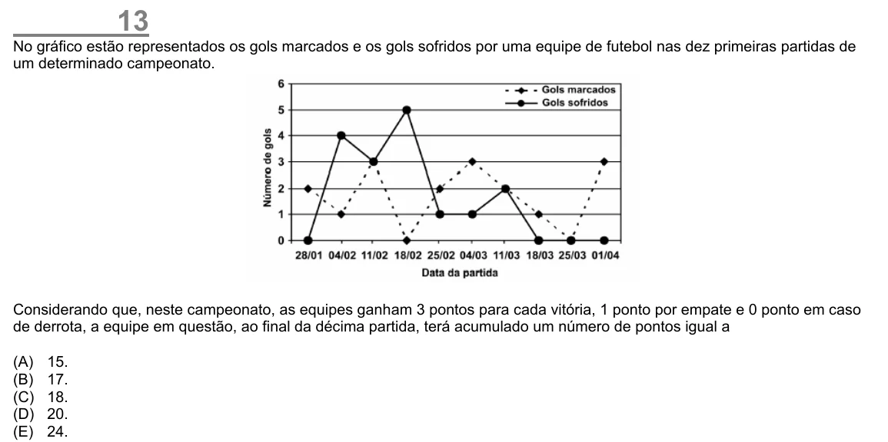

Texto extraído (pode conter ruído)

13  
No gráfico estão representados os gols marcados e os gols sofridos por uma equipe de futebol nas dez primeiras partidas de  
um determinado campeonato.  
Considerando que, neste campeonato, as equipes ganham 3 pontos para cada vitória, 1 ponto por empate e 0 ponto em caso  
de derrota, a equipe em questão, ao final da décima partida, terá acumulado um número de pontos igual a  
(A)  
15.  
(B)  
17.  
(C)  
18.  
(D)  
20.  
(E)  
24.

