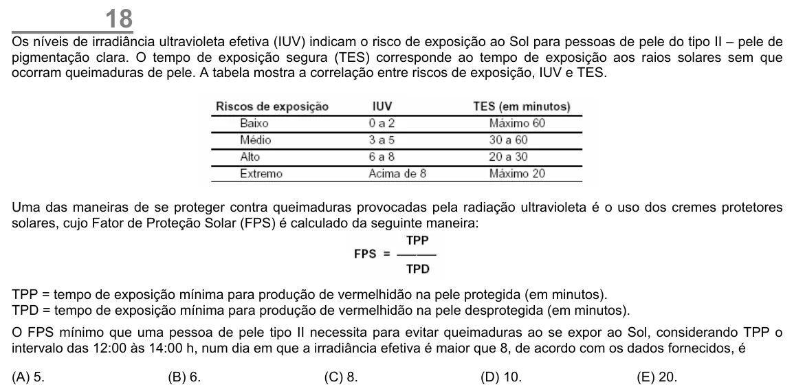

Texto extraído (pode conter ruído)

18  
Os níveis de irradiância ultravioleta efetiva (IUV) indicam o risco de exposição ao Sol para pessoas de pele do tipo II – pele de  
pigmentação clara. O tempo de exposição segura (TES) corresponde ao tempo de exposição aos raios solares sem que  
ocorram queimaduras de pele. A tabela mostra a correlação entre riscos de exposição, IUV e TES.  
Uma das maneiras de se proteger contra queimaduras provocadas pela radiação ultravioleta é o uso dos cremes protetores  
solares, cujo Fator de Proteção Solar (FPS) é calculado da seguinte maneira:  
TPP = tempo de exposição mínima para produção de vermelhidão na pele protegida (em minutos).  
TPD = tempo de exposição mínima para produção de vermelhidão na pele desprotegida (em minutos).  
O FPS mínimo que uma pessoa de pele tipo II necessita para evitar queimaduras ao se expor ao Sol, considerando TPP o  
intervalo das 12:00 às 14:00 h, num dia em que a irradiância efetiva é maior que 8, de acordo com os dados fornecidos, é  
(A) 5.  
(B) 6.  
(C) 8.  
(D) 10.  
(E) 20.

