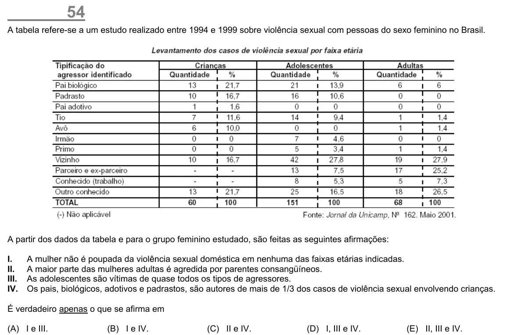

Texto extraído (pode conter ruído)

54  
A tabela refere-se a um estudo realizado entre 1994 e 1999 sobre violência sexual com pessoas do sexo feminino no Brasil.  
A partir dos dados da tabela e para o grupo feminino estudado, são feitas as seguintes afirmações:  
I.  
A mulher não é poupada da violência sexual doméstica em nenhuma das faixas etárias indicadas.  
II.  
A maior parte das mulheres adultas é agredida por parentes consangüíneos.  
III.  
As adolescentes são vítimas de quase todos os tipos de agressores.  
IV.  
Os pais, biológicos, adotivos e padrastos, são autores de mais de 1/3 dos casos de violência sexual envolvendo crianças.  
É verdadeiro apenas o que se afirma em  
(A) I e III.  
(B) I e IV.  
(C) II e IV.  
(D) I, III e IV.  
(E) II, III e IV.

