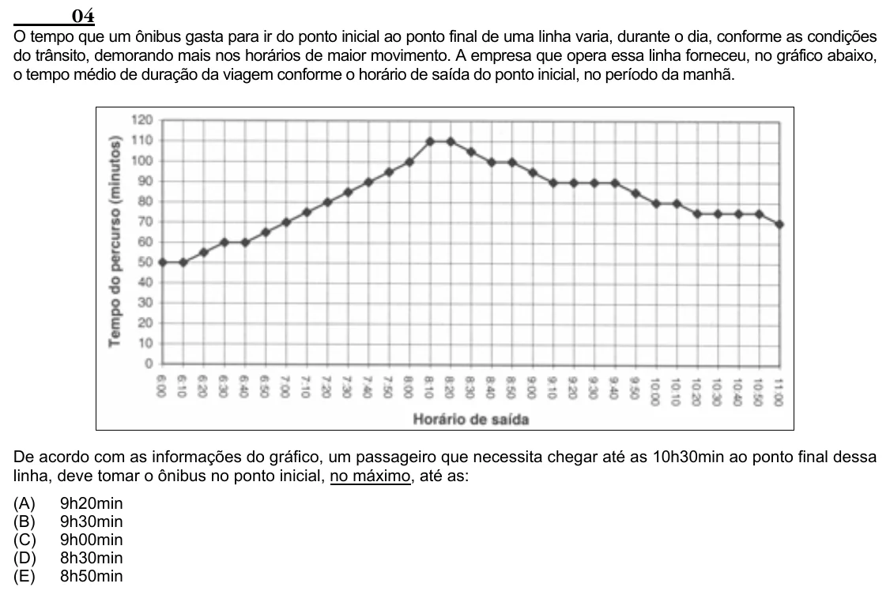

Texto extraído (pode conter ruído)

04  
O tempo que um ônibus gasta para ir do ponto inicial ao ponto final de uma linha varia, durante o dia, conforme as condições  
do trânsito, demorando mais nos horários de maior movimento. A empresa que opera essa linha forneceu, no gráfico abaixo,  
o tempo médio de duração da viagem conforme o horário de saída do ponto inicial, no período da manhã.  
De acordo com as informações do gráfico, um passageiro que necessita chegar até as 10h30min ao ponto final dessa  
linha, deve tomar o ônibus no ponto inicial, no máximo, até as:  
(A)  
9h20min  
(B)  
9h30min  
(C)  
9h00min  
(D)  
8h30min  
(E)  
8h50min

