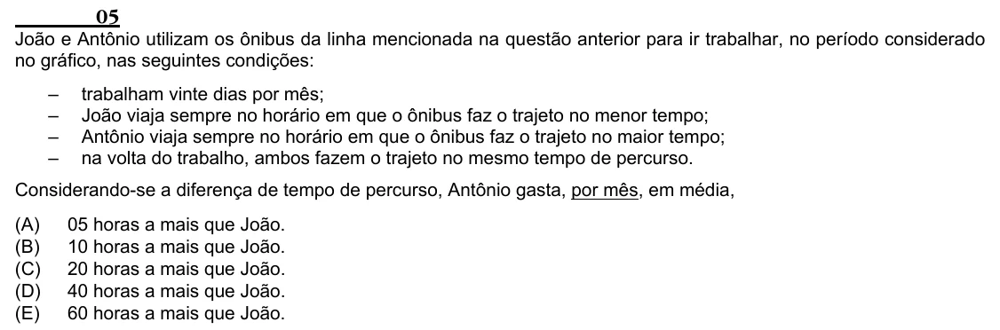

Texto extraído (pode conter ruído)

05  
João e Antônio utilizam os ônibus da linha mencionada na questão anterior para ir trabalhar, no período considerado  
no gráfico, nas seguintes condições:  
–  
trabalham vinte dias por mês;  
–  
João viaja sempre no horário em que o ônibus faz o trajeto no menor tempo;  
–  
Antônio viaja sempre no horário em que o ônibus faz o trajeto no maior tempo;  
–  
na volta do trabalho, ambos fazem o trajeto no mesmo tempo de percurso.  
Considerando-se a diferença de tempo de percurso, Antônio gasta, por mês, em média,  
(A)  
05 horas a mais que João.  
(B)  
10 horas a mais que João.  
(C)  
20 horas a mais que João.  
(D)  
40 horas a mais que João.  
(E)  
60 horas a mais que João.

