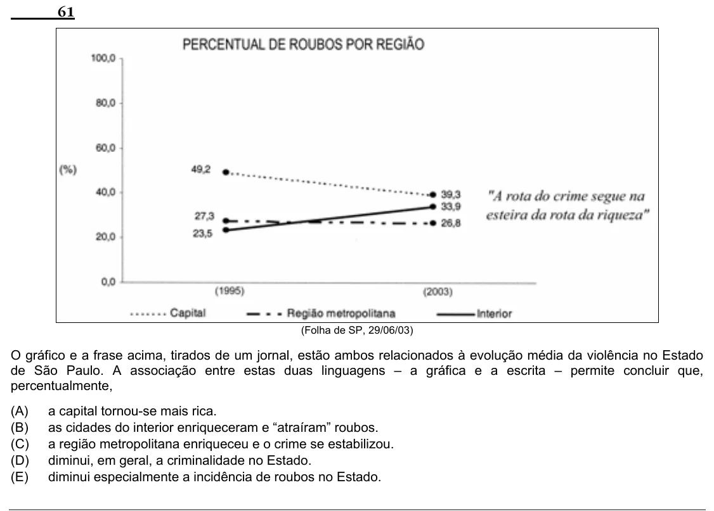

Texto extraído (pode conter ruído)

61  
(Folha de SP, 29/06/03)  
O gráfico e a frase acima, tirados de um jornal, estão ambos relacionados à evolução média da violência no Estado  
de São Paulo. A associação entre estas duas linguagens – a gráfica e a escrita – permite concluir que,  
percentualmente,  
(A)  
a capital tornou-se mais rica.  
(B)  
as cidades do interior enriqueceram e “atraíram” roubos.  
(C)  
a região metropolitana enriqueceu e o crime se estabilizou.  
(D)  
diminui, em geral, a criminalidade no Estado.  
(E)  
diminui especialmente a incidência de roubos no Estado.

