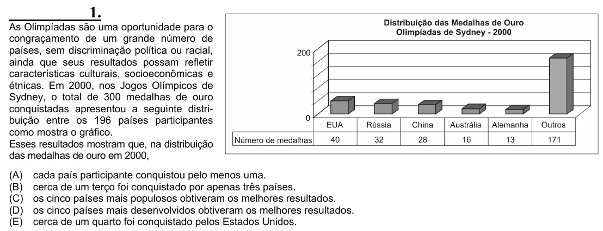

Texto extraído (pode conter ruído)

1.  
As Olimpíadas são uma oportunidade para o  
congraçamento de um grande número de  
países, sem discriminação política ou racial,  
ainda que seus resultados possam refletir  
características culturais, socioeconômicas e  
étnicas. Em 2000, nos Jogos Olímpicos de  
Sydney, o total de 300 medalhas de ouro  
conquistadas apresentou a seguinte distri-  
buição entre os 196 países participantes  
como mostra o gráfico.  
Esses resultados mostram que, na distribuição  
das medalhas de ouro em 2000,  
(A)  
cada país participante conquistou pelo menos uma.  
(B)  
cerca de um terço foi conquistado por apenas três países.  
(C)  
os cinco países mais populosos obtiveram os melhores resultados.  
(D)  
os cinco países mais desenvolvidos obtiveram os melhores resultados.  
(E)  
cerca de um quarto foi conquistado pelos Estados Unidos.

