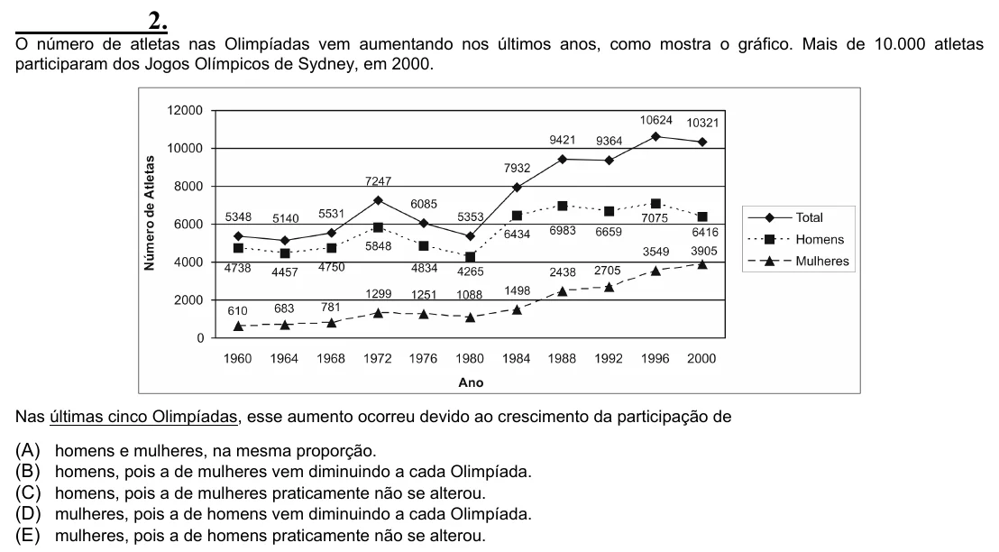

Texto extraído (pode conter ruído)

2.  
O número de atletas nas Olimpíadas vem aumentando nos últimos anos, como mostra o gráfico. Mais de 10.000 atletas  
participaram dos Jogos Olímpicos de Sydney, em 2000.  
Nas últimas cinco Olimpíadas, esse aumento ocorreu devido ao crescimento da participação de  
(A)  
homens e mulheres, na mesma proporção.  
(B)  
homens, pois a de mulheres vem diminuindo a cada Olimpíada.  
(C)  
homens, pois a de mulheres praticamente não se alterou.  
(D)  
mulheres, pois a de homens vem diminuindo a cada Olimpíada.  
(E)  
mulheres, pois a de homens praticamente não se alterou.

