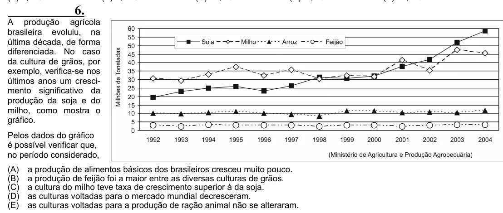

Texto extraído (pode conter ruído)

6.  
A produção agrícola  
brasileira evoluiu, na  
última década, de forma  
diferenciada. No caso  
da cultura de grãos, por  
exemplo, verifica-se nos  
últimos anos um cresci-  
mento significativo da  
produção da soja e do  
milho, como mostra o  
gráfico.  
Pelos dados do gráfico  
é possível verificar que,  
no período considerado,  
(A)  
a produção de alimentos básicos dos brasileiros cresceu muito pouco.  
(B)  
a produção de feijão foi a maior entre as diversas culturas de grãos.  
(C)  
a cultura do milho teve taxa de crescimento superior à da soja.  
(D)  
as culturas voltadas para o mercado mundial decresceram.  
(E)  
as culturas voltadas para a produção de ração animal não se alteraram.

