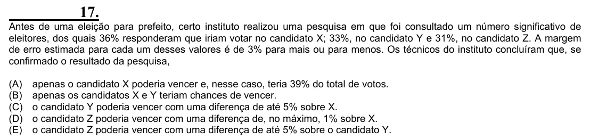

Texto extraído (pode conter ruído)

17.  
Antes de uma eleição para prefeito, certo instituto realizou uma pesquisa em que foi consultado um número significativo de  
eleitores, dos quais 36% responderam que iriam votar no candidato X; 33%, no candidato Y e 31%, no candidato Z. A margem  
de erro estimada para cada um desses valores é de 3% para mais ou para menos. Os técnicos do instituto concluíram que, se  
confirmado o resultado da pesquisa,  
(A)  
apenas o candidato X poderia vencer e, nesse caso, teria 39% do total de votos.  
(B)  
apenas os candidatos X e Y teriam chances de vencer.  
(C)  
o candidato Y poderia vencer com uma diferença de até 5% sobre X.  
(D)  
o candidato Z poderia vencer com uma diferença de, no máximo, 1% sobre X.  
(E)  
o candidato Z poderia vencer com uma diferença de até 5% sobre o candidato Y.

