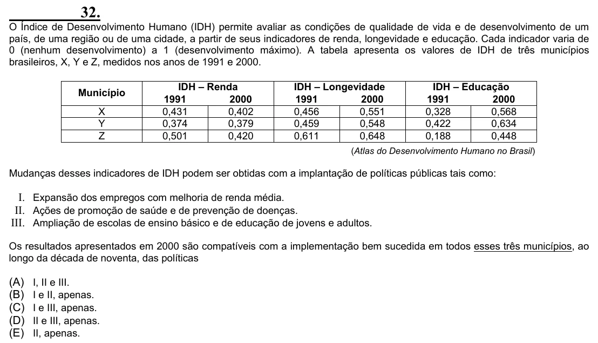

Texto extraído (pode conter ruído)

32.  
O Índice de Desenvolvimento Humano (IDH) permite avaliar as condições de qualidade de vida e de desenvolvimento de um  
país, de uma região ou de uma cidade, a partir de seus indicadores de renda, longevidade e educação. Cada indicador varia de  
0 (nenhum desenvolvimento) a 1 (desenvolvimento máximo). A tabela apresenta os valores de IDH de três municípios  
brasileiros, X, Y e Z, medidos nos anos de 1991 e 2000.  
IDH – Renda  
IDH – Longevidade  
IDH – Educação  
Município  
1991  
2000  
1991  
2000  
1991  
2000  
X  
0,431  
0,402  
0,456  
0,551  
0,328  
0,568  
Y  
0,374  
0,379  
0,459  
0,548  
0,422  
0,634  
Z  
0,501  
0,420  
0,611  
0,648  
0,188  
0,448  
(Atlas do Desenvolvimento Humano no Brasil)  
Mudanças desses indicadores de IDH podem ser obtidas com a implantação de políticas públicas tais como:  
I. Expansão dos empregos com melhoria de renda média.  
II. Ações de promoção de saúde e de prevenção de doenças.  
III. Ampliação de escolas de ensino básico e de educação de jovens e adultos.  
Os resultados apresentados em 2000 são compatíveis com a implementação bem sucedida em todos esses três municípios, ao  
longo da década de noventa, das políticas  
(A)  
I, II e III.  
(B)  
I e II, apenas.  
(C)  
I e III, apenas.  
(D)  
II e III, apenas.  
(E)  
II, apenas.

