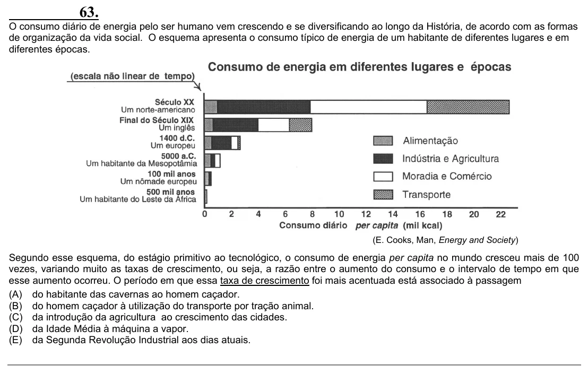

Texto extraído (pode conter ruído)

63.  
O consumo diário de energia pelo ser humano vem crescendo e se diversificando ao longo da História, de acordo com as formas  
de organização da vida social. O esquema apresenta o consumo típico de energia de um habitante de diferentes lugares e em  
diferentes épocas.  
(E. Cooks, Man, Energy and Society)  
Segundo esse esquema, do estágio primitivo ao tecnológico, o consumo de energia per capita no mundo cresceu mais de 100  
vezes, variando muito as taxas de crescimento, ou seja, a razão entre o aumento do consumo e o intervalo de tempo em que  
esse aumento ocorreu. O período em que essa taxa de crescimento foi mais acentuada está associado à passagem  
(A) do habitante das cavernas ao homem caçador.  
(B) do homem caçador à utilização do transporte por tração animal.  
(C) da introdução da agricultura ao crescimento das cidades.  
(D) da Idade Média à máquina a vapor.  
(E) da Segunda Revolução Industrial aos dias atuais.

