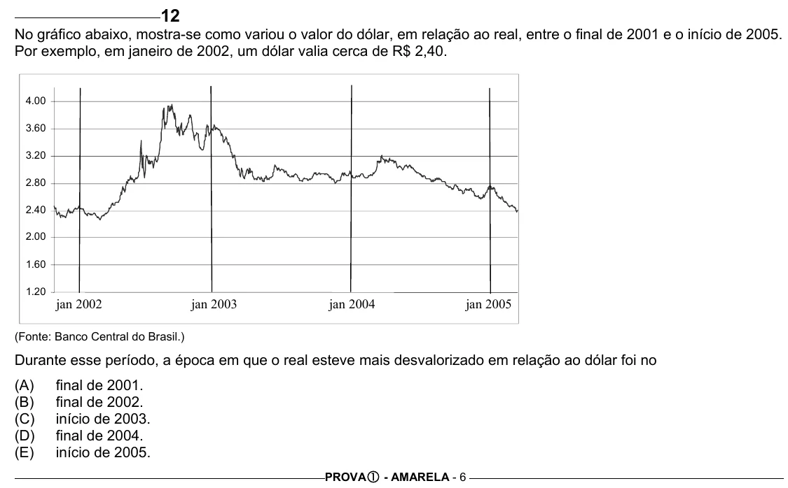

Texto extraído (pode conter ruído)

12  
No gráfico abaixo, mostra-se como variou o valor do dólar, em relação ao real, entre o final de 2001 e o início de 2005.  
Por exemplo, em janeiro de 2002, um dólar valia cerca de R$ 2,40.  
4.00  
3.60  
3.20  
2.80  
2.40  
2.00  
1.60  
1.20  
jan 2002  
jan 2003  
jan 2004  
jan 2005  
(Fonte: Banco Central do Brasil.)  
Durante esse período, a época em que o real esteve mais desvalorizado em relação ao dólar foi no  
(A)  
final de 2001.  
(B)  
final de 2002.  
(C)  
início de 2003.  
(D)  
final de 2004.  
(E)  
início de 2005.  
PROVA c - AMARELA - 6

