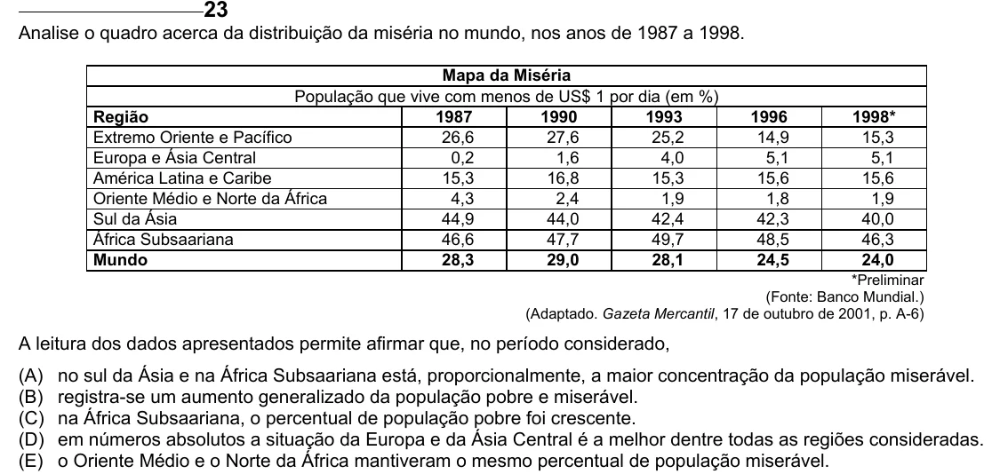

Texto extraído (pode conter ruído)

Analise o quadro acerca da distribuição da miséria no mundo, nos anos de 1987 a 1998.  
Mapa da Miséria  
População que vive com menos de US$ 1 por dia (em %)  
Região  
1987  
1990  
1993  
1996  
1998*  
Extremo Oriente e Pacífico  
26,6  
27,6  
25,2  
14,9  
15,3  
Europa e Ásia Central  
0,2  
1,6  
4,0  
5,1  
5,1  
América Latina e Caribe  
15,3  
16,8  
15,3  
15,6  
15,6  
Oriente Médio e Norte da África  
4,3  
2,4  
1,9  
1,8  
1,9  
Sul da Ásia  
44,9  
44,0  
42,4  
42,3  
40,0  
África Subsaariana  
46,6  
47,7  
49,7  
48,5  
46,3  
Mundo  
28,3  
29,0  
28,1  
24,5  
24,0  
*Preliminar  
(Fonte: Banco Mundial.)  
(Adaptado. Gazeta Mercantil, 17 de outubro de 2001, p. A-6)  
A leitura dos dados apresentados permite afirmar que, no período considerado,  
(A)  
no sul da Ásia e na África Subsaariana está, proporcionalmente, a maior concentração da população miserável.  
(B)  
registra-se um aumento generalizado da população pobre e miserável.  
(C)  
na África Subsaariana, o percentual de população pobre foi crescente.  
(D)  
em números absolutos a situação da Europa e da Ásia Central é a melhor dentre todas as regiões consideradas.  
(E)  
o Oriente Médio e o Norte da África mantiveram o mesmo percentual de população miserável.

