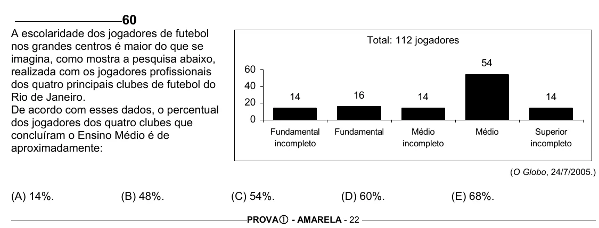

Texto extraído (pode conter ruído)

60  
A escolaridade dos jogadores de futebol  
Total: 112 jogadores  
nos grandes centros é maior do que se  
imagina, como mostra a pesquisa abaixo,  
54  
60  
realizada com os jogadores profissionais  
dos quatro principais clubes de futebol do  
40  
16  
Rio de Janeiro.  
14  
14  
14  
20  
De acordo com esses dados, o percentual  
0  
dos jogadores dos quatro clubes que  
Fundamental  
Fundamental  
Médio  
Médio  
Superior  
concluíram o Ensino Médio é de  
incompleto  
incompleto  
incompleto  
aproximadamente:  
(O Globo, 24/7/2005.)  
(A) 14%.  
(B) 48%.  
(C) 54%.  
(D) 60%.  
(E) 68%.  
PROVA c - AMARELA - 22

