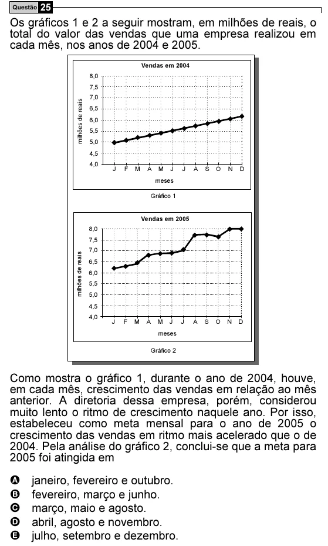

Texto extraído (pode conter ruído)

Questão 25  
Os gráficos 1 e 2 a seguir mostram, em milhões de reais, o  
total do valor das vendas que uma empresa realizou em  
cada mês, nos anos de 2004 e 2005.  
Vendas em 2004  
8,0  
7,5  
7,0  
milhões de reais  
6,5  
6,0  
5,5  
5,0  
4,5  
4,0  
J  
F  
M  
A  
M  
J  
J  
A  
S  
O  
N  
D  
meses  
Gráfico 1  
Vendas em 2005  
8,0  
7,5  
7,0  
milhões de reais  
6,5  
6,0  
5,5  
5,0  
4,5  
4,0  
J  
F  
M  
A  
M  
J  
J  
A  
S  
O  
N  
D  
meses  
Gráfico 2  
Como mostra o gráfico 1, durante o ano de 2004, houve,  
em cada mês, crescimento das vendas em relação ao mês  
anterior. A diretoria dessa empresa, porém, considerou  
muito lento o ritmo de crescimento naquele ano. Por isso,  
estabeleceu como meta mensal para o ano de 2005 o  
crescimento das vendas em ritmo mais acelerado que o de  
2004. Pela análise do gráfico 2, conclui-se que a meta para  
2005 foi atingida em  
A  
janeiro, fevereiro e outubro.  
B  
fevereiro, março e junho.  
C  
março, maio e agosto.  
D  
abril, agosto e novembro.  
E  
julho, setembro e dezembro.

