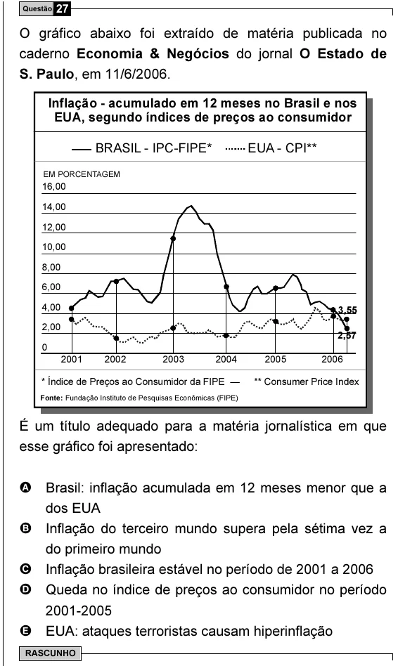

Texto extraído (pode conter ruído)

Questão 27  
O gráfico abaixo foi extraído de matéria publicada no  
caderno Economia & Negócios do jornal O Estado de  
S. Paulo, em 11/6/2006.  
Inflação - acumulado em 12 meses no Brasil e nos  
EUA, segundo índices de preços ao consumidor  
BRASIL - IPC-FIPE*  
EUA - CPI**  
EM PORCENTAGEM  
16,00  
14,00  
12,00  
10,00  
8,00  
6,00  
4,00  
3,55  
2,00  
2,57  
0  
2001  
2002  
2003  
2004  
2005  
2006  
* Índice de Preços ao Consumidor da FIPE  
** Consumer Price Index  
Fonte: Fundação Instituto de Pesquisas Econômicas (FIPE)  
É um título adequado para a matéria jornalística em que  
esse gráfico foi apresentado:  
A Brasil: inflação acumulada em 12 meses menor que a  
dos EUA  
B Inflação do terceiro mundo supera pela sétima vez a  
do primeiro mundo  
C Inflação brasileira estável no período de 2001 a 2006  
D Queda no índice de preços ao consumidor no período  
2001-2005  
E EUA: ataques terroristas causam hiperinflação  
RASCUNHO

