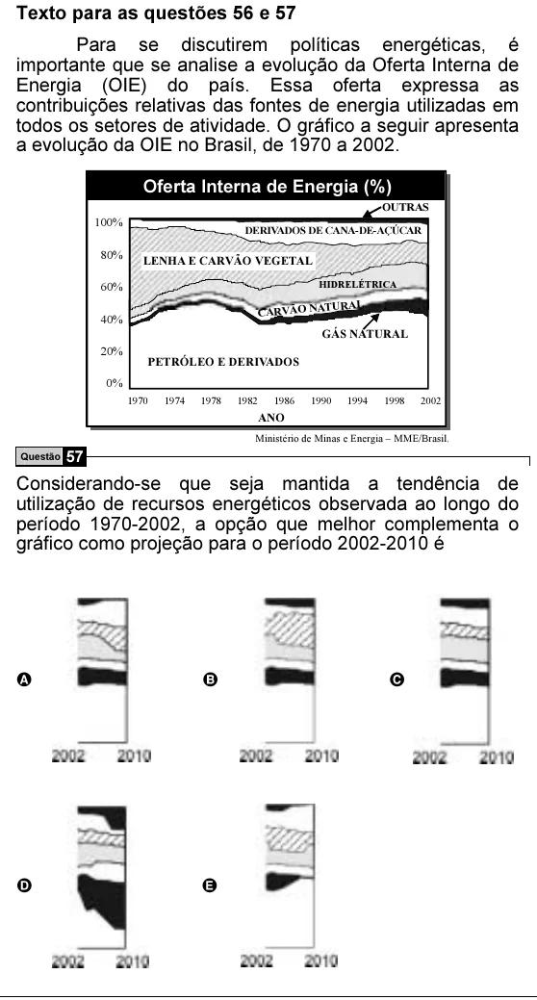

Texto extraído (pode conter ruído)

Texto para as questões 56 e 57  
Para se discutirem políticas energéticas, é  
importante que se analise a evolução da Oferta Interna de  
Energia (OIE) do país. Essa oferta expressa as  
contribuições relativas das fontes de energia utilizadas em  
todos os setores de atividade. O gráfico a seguir apresenta  
a evolução da OIE no Brasil, de 1970 a 2002.  
Oferta Interna de Energia (%)  
OUTRAS  
100%  
DERIVADOS DE CANA-DE-AÇÚCAR  
80%  
LENHA E CARVÃO VEGETAL  
60%  
HIDRELÉTRICA  
CARVÃO NA  
TURAL  
40%  
GÁS NATURAL  
20%  
PETRÓLEO E DERIVADOS  
0%  
1970  
1974  
1978  
1982  
1986  
1990  
1994  
1998  
2002  
ANO  
Ministério de Minas e Energia – MME/Brasil.  
Questão 57  
Considerando-se que seja mantida a tendência de  
utilização de recursos energéticos observada ao longo do  
período 1970-2002, a opção que melhor complementa o  
gráfico como projeção para o período 2002-2010 é  
A  
B  
C  
D  
E

