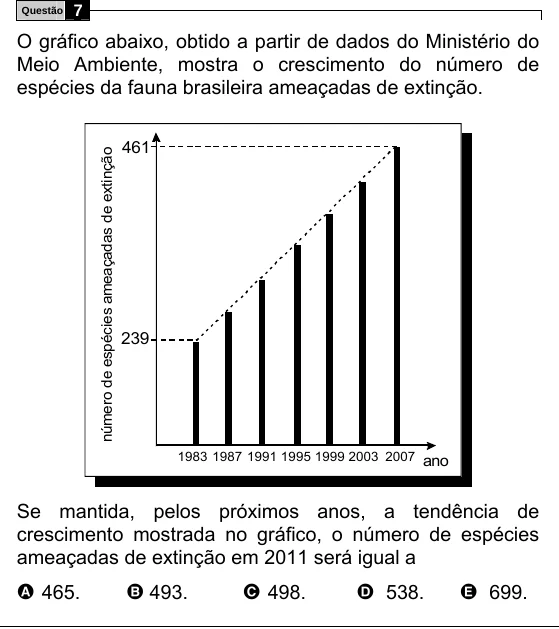

Texto extraído (pode conter ruído)

Questão  
7  
O gráfico abaixo, obtido a partir de dados do Ministério do  
Meio Ambiente, mostra o crescimento do número de  
espécies da fauna brasileira ameaçadas de extinção.  
461  
número de espécies ameaçadas de extinção  
239  
1983 1987 1991 1995 1999 2003 2007 ano  
Se mantida, pelos próximos anos, a tendência de  
crescimento mostrada no gráfico, o número de espécies  
ameaçadas de extinção em 2011 será igual a  
A 465.  
B 493.  
C 498.  
D 538.  
E 699.

