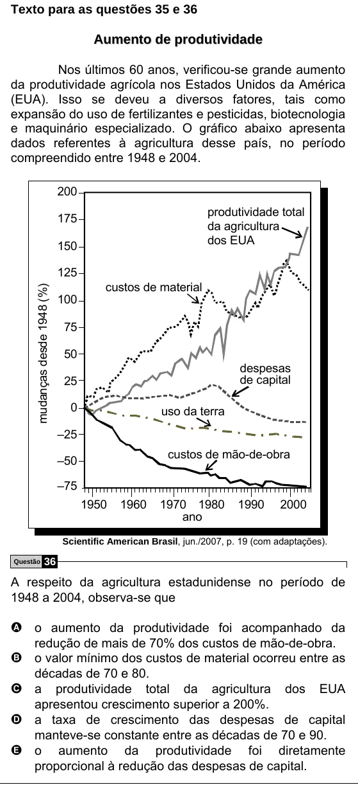

Texto extraído (pode conter ruído)

Texto para as questões 35 e 36  
A u m e n t o d e p r o d u t i v i d a d e  
Nos últimos 60 anos, verificou-se grande aumento  
da produtividade agrícola nos Estados Unidos da América  
(EUA). Isso se deveu a diversos fatores, tais como  
expansão do uso de fertilizantes e pesticidas, biotecnologia  
e maquinário especializado. O gráfico abaixo apresenta  
dados referentes à agricultura desse país, no período  
compreendido entre 1948 e 2004.  
200  
produtividade total  
175  
da agricultura  
dos EUA  
150  
125  
custos de material  
mudanças desde 1948 (%)  
100  
75  
50  
despesas  
de capital  
25  
0  
uso da terra  
–25  
custos de mão-de-obra  
–50  
–75  
1950  
1960  
1970 1980  
1990  
2000  
ano  
Scientific American Brasil, jun./2007, p. 19 (com adaptações).  
36  
Questão  
A respeito da agricultura estadunidense no período de  
1948 a 2004, observa-se que  
A o aumento da produtividade foi acompanhado da  
redução de mais de 70% dos custos de mão-de-obra.  
B o valor mínimo dos custos de material ocorreu entre as  
décadas de 70 e 80.  
C a  
produtividade total da agricultura dos EUA  
apresentou crescimento superior a 200%.  
D a taxa de crescimento das despesas de capital  
manteve-se constante entre as décadas de 70 e 90.  
E o aumento da produtividade foi diretamente  
proporcional à redução das despesas de capital.

