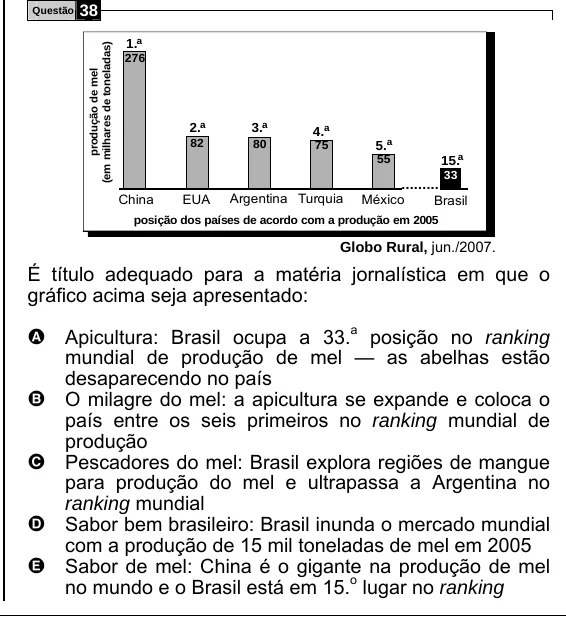

Texto extraído (pode conter ruído)

Questão  
38  
1. a  
(em milhares de toneladas)  
276  
produção de mel  
2. a  
3. a  
4. a  
82  
80  
5. a  
75  
15. a  
55  
33  
..........  
China  
EUA  
Argentina Turquia  
México  
Brasil  
posição dos países de acordo com a produção em 2005  
Globo Rural, jun./2007.  
É título adequado para a matéria jornalística em que o  
gráfico acima seja apresentado:  
A Apicultura: Brasil ocupa a 33. a posição no ranking  
mundial de produção de mel — as abelhas estão  
desaparecendo no país  
O milagre do mel: a apicultura se expande e coloca o  
B  
país entre os seis primeiros no ranking mundial de  
produção  
Pescadores do mel: Brasil explora regiões de mangue  
C  
para produção do mel e ultrapassa a Argentina no  
ranking mundial  
Sabor bem brasileiro: Brasil inunda o mercado mundial  
D  
com a produção de 15 mil toneladas de mel em 2005  
E  
Sabor de mel: China é o gigante na produção de mel  
no mundo e o Brasil está em 15. o lugar no ranking

