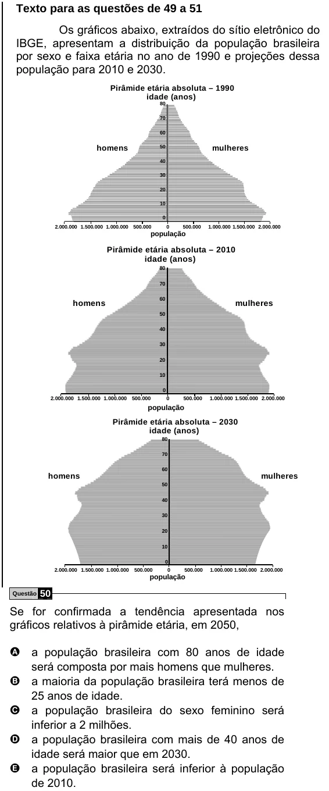

Texto extraído (pode conter ruído)

Texto para as questões de 49 a 51  
Os gráficos abaixo, extraídos do sítio eletrônico do  
IBGE, apresentam a distribuição da população brasileira  
por sexo e faixa etária no ano de 1990 e projeções dessa  
população para 2010 e 2030.  
Pirâmide etária absoluta – 1990  
idade (anos)  
80  
70  
60  
homens  
50  
mulheres  
40  
30  
20  
10  
0  
2.000.000 1.500.000 1.000.000 500.000  
0  
500.000  
1.000.000 1.500.000 2.000.000  
população  
Pirâmide etária absoluta – 2010  
idade (anos)  
80  
70  
60  
homens  
mulheres  
50  
40  
30  
20  
10  
0  
2.000.000 1.500.000 1.000.000 500.000  
0  
500.000  
1.000.000 1.500.000 2.000.000  
população  
Pirâmide etária absoluta – 2030  
idade (anos)  
80  
70  
60  
homens  
mulheres  
50  
40  
30  
20  
10  
0  
2.000.000 1.500.000 1.000.000  
500.000  
0  
500.000  
1.000.000 1.500.000 2.000.000  
população  
Questão  
50  
Se for confirmada a tendência apresentada nos  
gráficos relativos à pirâmide etária, em 2050,  
A a população brasileira com 80 anos de idade  
será composta por mais homens que mulheres.  
B a maioria da população brasileira terá menos de  
25 anos de idade.  
C a população brasileira do sexo feminino será  
inferior a 2 milhões.  
D a população brasileira com mais de 40 anos de  
idade será maior que em 2030.  
E a população brasileira será inferior à população  
de 2010.

