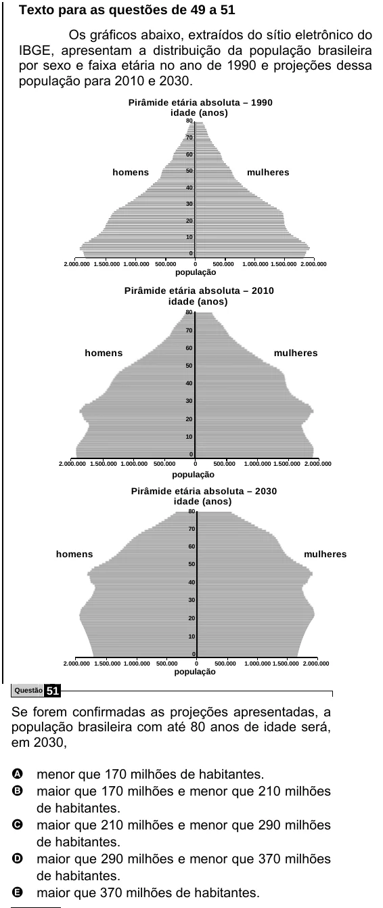

Texto extraído (pode conter ruído)

Texto para as questões de 49 a 51  
Os gráficos abaixo, extraídos do sítio eletrônico do  
IBGE, apresentam a distribuição da população brasileira  
por sexo e faixa etária no ano de 1990 e projeções dessa  
população para 2010 e 2030.  
Pirâmide etária absoluta – 1990  
idade (anos)  
80  
70  
60  
homens  
50  
mulheres  
40  
30  
20  
10  
0  
2.000.000 1.500.000 1.000.000 500.000  
0  
500.000  
1.000.000 1.500.000 2.000.000  
população  
Pirâmide etária absoluta – 2010  
idade (anos)  
80  
70  
60  
homens  
mulheres  
50  
40  
30  
20  
10  
0  
2.000.000 1.500.000 1.000.000 500.000  
0  
500.000  
1.000.000 1.500.000 2.000.000  
população  
Pirâmide etária absoluta – 2030  
idade (anos)  
80  
70  
60  
homens  
mulheres  
50  
40  
30  
20  
10  
0  
2.000.000 1.500.000 1.000.000  
500.000  
0  
500.000  
1.000.000 1.500.000 2.000.000  
população  
Questão  
51  
Se forem confirmadas as projeções apresentadas, a  
população brasileira com até 80 anos de idade será,  
em 2030,  
A menor que 170 milhões de habitantes.  
B maior que 170 milhões e menor que 210 milhões  
de habitantes.  
C maior que 210 milhões e menor que 290 milhões  
de habitantes.  
D maior que 290 milhões e menor que 370 milhões  
de habitantes.  
E maior que 370 milhões de habitantes.

