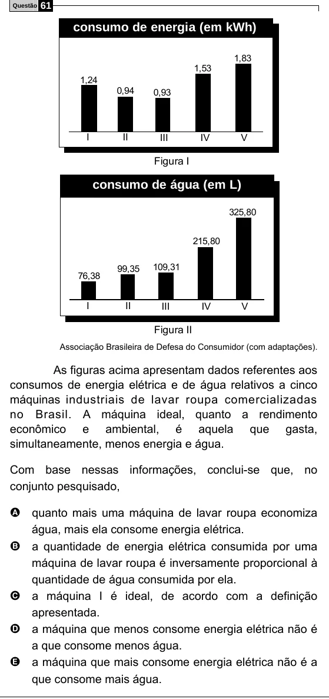

Texto extraído (pode conter ruído)

Questão  
61  
consumo de energia (em kWh)  
1,83  
1,53  
1,24  
0,94  
0,93  
I  
II  
III  
IV  
V  
Figura I  
consumo de água (em L)  
325,80  
215,80  
109,31  
99,35  
76,38  
I  
II  
III  
IV  
V  
Figura II  
Associação Brasileira de Defesa do Consumidor (com adaptações).  
As figuras acima apresentam dados referentes aos  
consumos de energia elétrica e de água relativos a cinco  
máquinas industriais de lavar roupa comercializadas  
no Brasil. A máquina ideal, quanto a rendimento  
econômico e ambiental, é aquela que gasta,  
simultaneamente, menos energia e água.  
Com base nessas informações, conclui-se que, no  
conjunto pesquisado,  
A quanto mais uma máquina de lavar roupa economiza  
água, mais ela consome energia elétrica.  
B  
a quantidade de energia elétrica consumida por uma  
máquina de lavar roupa é inversamente proporcional à  
quantidade de água consumida por ela.  
a máquina I é ideal, de acordo com a definição  
C  
apresentada.  
a máquina que menos consome energia elétrica não é  
D  
a que consome menos água.  
a máquina que mais consome energia elétrica não é a  
E  
que consome mais água.

