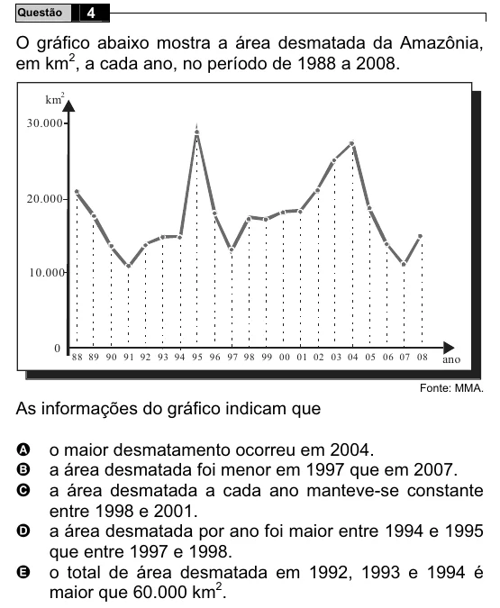

Texto extraído (pode conter ruído)

4  
Questão  
O gráfico abaixo mostra a área desmatada da Amazônia,  
em km 2 , a cada ano, no período de 1988 a 2008.  
km  
2  
30.000  
20.000  
10.000  
0  
88 89 90 91 92 93 94 95 96 97 98 99 00 01 02 03 04 05 06 07 08  
ano  
Fonte: MMA.  
As informações do gráfico indicam que  
A  
o maior desmatamento ocorreu em 2004.  
a área desmatada foi menor em 1997 que em 2007.  
B  
C  
a área desmatada a cada ano manteve-se constante  
entre 1998 e 2001.  
a área desmatada por ano foi maior entre 1994 e 1995  
D  
que entre 1997 e 1998.  
o total de área desmatada em 1992, 1993 e 1994 é  
E  
maior que 60.000 km 2 .

